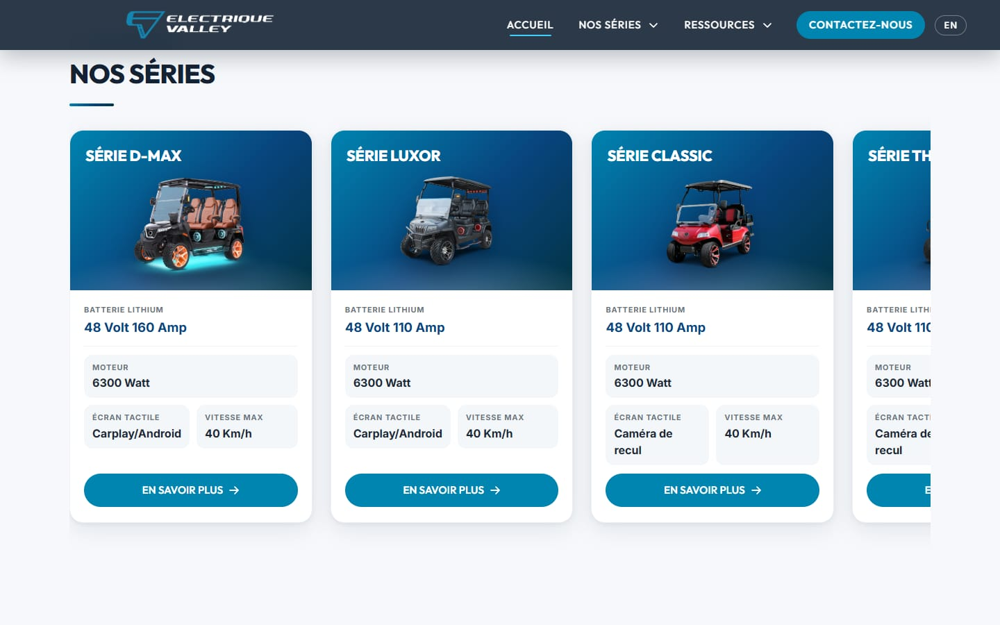
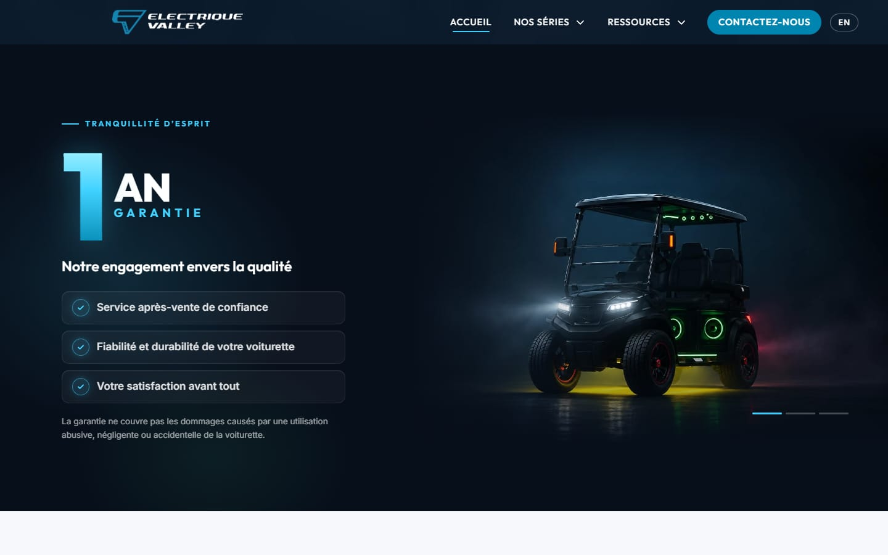
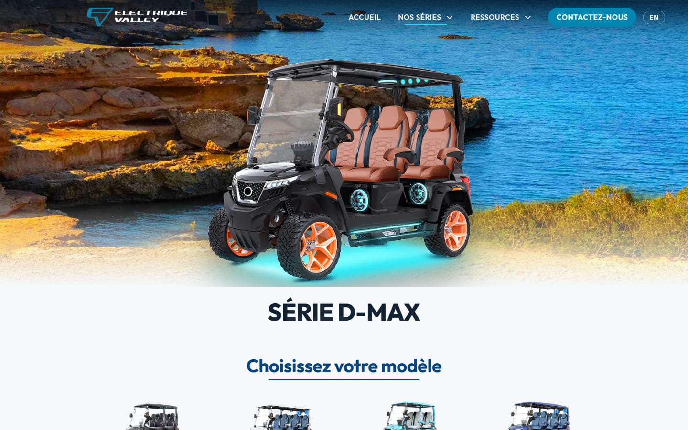
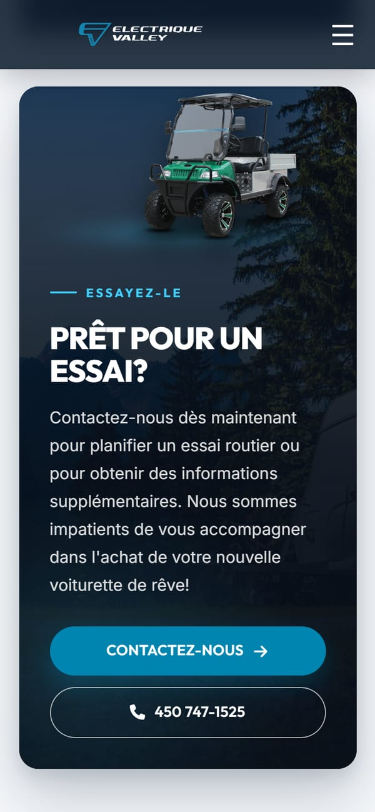

# Electrique Valley — Website

**A bilingual website for an electric golf cart dealer in Salaberry-de-Valleyfield, Quebec.**
React + TypeScript front end, Node/Express API, pre-rendered pages, deployed on AWS Lightsail.

🌐 **Live:** [electriquevalley.com](https://www.electriquevalley.com)



| Warranty section | D-MAX series page | Mobile |
|---|---|---|
|  |  |  |

---

## About the project

Electrique Valley sells electric golf carts and utility vehicles. The owner needed a site that presents each series (D-MAX, Luxor, Classic, Thor), lets customers book a test ride or ask a question, and works equally well in French and English. In Quebec, the French version must be at least as complete as the English one.

I built the first version (React front end, Express API, MySQL, contact and newsletter emails, video showcase) and then reworked it into a modern, fast and legally compliant site.

## Highlights

**Bilingual routing that search engines understand**
French lives at `/`, English under `/en`, each with its own translated URLs (`/serie-dmax` ↔ `/en/dmax-series`). A single route map drives React Router, the language switch, `hreflang`/canonical tags, the sitemap and the 301 redirects from the old URLs.

**Pre-rendering a Create React App site**
A build script starts the production build in headless Chrome (Puppeteer), saves every page (20 in all) as static HTML, adds a preload for each page's main image, and fails the build if a page has a missing file or no `<h1>`. nginx serves those files first and falls back to the app shell. Visitors and crawlers get real content before JavaScript runs.

**Scroll-driven series carousel at every screen size**
The series cards slide sideways while the page scrolls down, using only CSS `position: sticky` and one scroll listener (GSAP was removed). The pinned block measures itself and scales down to fit short screens, such as a phone held sideways, so it never overlaps the next section.

**Performance**
Images were resized to their display size and converted to WebP, off-screen images load lazily, and the hero image is preloaded. Measured on an emulated phone (slow 4G, 4× slower CPU):

| Page | Before | After |
|---|---|---|
| D-MAX series: page weight | 20.9 MB | 3.2 MB |
| D-MAX series: main image visible | 19.0 s | 3.4 s |
| Home: page weight | 9.2 MB | 2.5 MB |

**Quebec Law 25 and anti-spam (CASL)**
Privacy policy and terms of use in both languages, unchecked consent boxes, no tracking cookies (so no cookie banner), and newsletter unsubscribe links signed with an HMAC token, so nobody can unsubscribe someone else.

**Accessibility and motion**
Keyboard focus rings, alt text in both languages, WCAG AA contrast, and every animation turned off when the visitor has "reduce motion" enabled.

**Form security**
Per-IP rate limiting, a hidden honeypot field, server-side validation of every input, and CORS restricted to the site's own addresses.

## Tech stack

| Part | Technologies |
|---|---|
| Front end (`client/`) | React 18, TypeScript, React Router, Create React App, Puppeteer (pre-rendering) |
| API (`server/`) | Node.js, Express, TypeScript, TypeORM, MySQL, Nodemailer |
| Hosting | AWS Lightsail (Ubuntu), nginx (static files, reverse proxy, HTTPS with Let's Encrypt), pm2 |

**How it was built:** I wrote the site by hand in React and Node. Later in the project I used Claude Code (an AI coding assistant) for refactoring, responsive testing across screen sizes, and image optimization.

## Project structure

```
client/   React website; scripts/prerender.mjs pre-renders every page after the build
server/   Express API: contact form, newsletter and video endpoints
deploy/   nginx and pm2 configs, server setup script, step-by-step migration guide
docs/     Project brief, decisions, task list, launch checklist, screenshots
```

### API endpoints

| Method | Route | Purpose |
|---|---|---|
| POST | `/api/email/send-email` | Contact form |
| POST | `/api/email/subscribe` | Newsletter sign-up |
| POST | `/api/email/unsubscribe` | Newsletter unsubscribe |
| GET | `/api/videoCapsules` | List of showcase videos |
| GET | `/videos/:file` | Streams a video file |

## Running locally

Requirements: Node.js 20+ and a MySQL database.

```bash
# API
cd server
cp .env.example .env      # then fill in the values
npm install
npm run dev               # http://localhost:5000

# Website (second terminal)
cd client
npm install
npm start                 # http://localhost:3000
```

The website reads the API address from `REACT_APP_API_URL` (`client/.env.development` locally, `client/.env.production` for the live build).

## Deployment

```bash
cd client && npm run build                 # static files in client/build, every page pre-rendered
cd server && npm run build && npm start    # compiled API in server/dist (run with pm2 in production)
```

Videos are not stored in git; they are uploaded to the server separately. The full zero-downtime migration to AWS Lightsail (database, API, nginx, HTTPS before the DNS switch) is documented in [deploy/MIGRATION.md](deploy/MIGRATION.md).

## Author

**Jean-François Drouin**, analyst-programmer, Montérégie, Quebec
[github.com/j-fdev](https://github.com/j-fdev)
